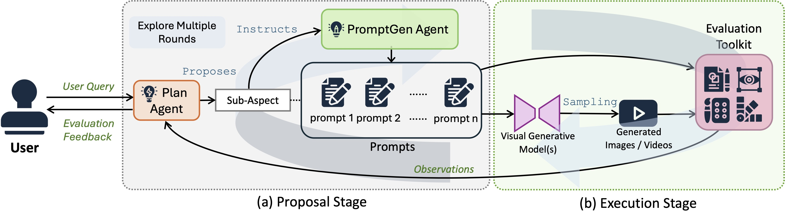

[](https://arxiv.org/abs/2412.09645)
[](https://vchitect.github.io/Evaluation-Agent-project/)
[](https://huggingface.co/open-ea)


<div align="center">
<h1>Evaluation Agent: Efficient and Promptable Evaluation Framework for Visual Generative Models
</h1></div>

<div align="center">
    <a href="https://github.com/zhangfan-p" target="_blank">Fan Zhang</a>*,
    <a href="https://shulin16.github.io/" target="_blank">Shulin Tian</a>*,
    <a href="https://ziqihuangg.github.io/" target="_blank">Ziqi Huang</a>‡*,
    <a href="http://mmlab.siat.ac.cn/yuqiao/index.html" target="_blank">Yu Qiao</a><sup>+</sup>,
    <a href="https://liuziwei7.github.io/" target="_blank">Ziwei Liu</a><sup>+</sup>
</div>

<div align="center">
     * equal contributions &nbsp;&nbsp;&nbsp;&nbsp;&nbsp; 
     ‡ project lead &nbsp;&nbsp;&nbsp;&nbsp;&nbsp; 
     + corresponding authors
</div>

<div align="center">
    ACL 2025, Main Conference<br>
    <font color="red">Oral, SAC Highlights Award (47 out of 8350)</font>
</div>


<a name="overview"></a>
## :mega: Overview

Recent advancements in visual generative models have enabled high-quality image and video generation, opening diverse applications. However, evaluating these models often demands sampling hundreds or thousands of images or videos, making the process computationally expensive, especially for diffusion-based models with inherently slow sampling. Moreover, existing evaluation methods rely on rigid pipelines that overlook specific user needs and provide numerical results without clear explanations. In contrast, humans can quickly form impressions of a model's capabilities by observing only a few samples. To mimic this, we propose the Evaluation Agent framework, which employs human-like strategies for efficient, dynamic, multi-round evaluations using only a few samples per round, while offering detailed, user-tailored analyses. It offers four key advantages: 1) efficiency, 2) promptable evaluation tailored to diverse user needs, 3) explainability beyond single numerical scores, and 4) scalability across various models and tools. Experiments show that Evaluation Agent reduces evaluation time to 10% of traditional methods while delivering comparable results. The Evaluation Agent framework is fully open-sourced to advance research in visual generative models and their efficient evaluation.




**Overview of Evaluation Agent Framework.** This framework leverages LLM-powered agents for efficient and flexible visual model assessments. As shown, it consists of two stages: (a) the Proposal Stage, where user queries are decomposed into sub-aspects, and prompts are generated, and (b) the Execution Stage, where visual content is generated and evaluated using an Evaluation Toolkit. The two stages interact iteratively to dynamically assess models based on user queries.

## Open-EA

**Open Evaluation Agent (Open-EA)** turns completed, multi-round evaluation rollouts into history-conditioned supervision and transfers the evaluation protocol to a compact local planner. Open-EA introduces the EA-CoT training corpus and **EA-3B**, initialized from Qwen2.5-3B-Instruct.

The canonical **EA-CoT-10K** T2V core contains **10,042 table-context records**: 7,494 tool-decision records and 2,548 summary records spanning all 15 VBench tools. The separately published **EA-CoT-T2I** companion contains **986 records** (739 tool-decision and 247 summary records) across four T2I-CompBench tools and is **not used in the current EA-3B training run**.

EA-3B is obtained by full-parameter supervised fine-tuning of Qwen2.5-3B-Instruct on the 10,042-record T2V core. See [training](./training/) for the cleaned history-conditioned training recipe. All official Open-EA model and dataset artifacts are published under the [`open-ea`](https://huggingface.co/open-ea) Hugging Face organization.

<a name="installation"></a>
## :hammer: Installation

1. Clone the repository and initialize its pinned third-party submodules.

```bash
git clone --recurse-submodules https://github.com/Vchitect/Evaluation-Agent.git
cd Evaluation-Agent
```

For an existing checkout that was cloned without submodules, run:

```bash
git submodule update --init --recursive
```

2. Install the environment.
```bash
conda create -n eval_agent python=3.10
conda activate eval_agent
pip install -r requirements.txt
```


<a name="usage"></a>
## Usage

### Local Open-EA Evaluation on T2V Models

The Open-EA runtime uses two OpenAI-compatible local endpoints: EA-3B plans the evaluation, while Qwen2.5-3B-Instruct selects prompts from the relevant VBench list. Install [vLLM](https://docs.vllm.ai/en/latest/getting_started/installation.html) in a model-serving environment and start both services from the repository root, normally on separate GPUs and in separate terminals:

```bash
CUDA_VISIBLE_DEVICES=0 bash scripts/serve_open_ea.sh planner
```

```bash
CUDA_VISIBLE_DEVICES=1 bash scripts/serve_open_ea.sh prompt
```

The launchers bind to `127.0.0.1` by default because the endpoints have no authentication. Set `OPEN_EA_HOST` explicitly only when remote access is intended and protected by appropriate network controls.

After preparing the target video model and the required VBench dependencies, use an additional GPU (or otherwise allocate devices according to the generator's requirements) and run:

```bash
cd eval_agent
CUDA_VISIBLE_DEVICES=2 python eval_agent_for_vbench_open.py \
    --user_query "How well does the model preserve subject consistency?" \
    --model latte1
```

### API-backed Evaluation Agent

The original API-backed pipeline requires an OpenAI API key:

```
export OPENAI_API_KEY="your_api_key_here"
```

### Evaluation of Open-ended Questions on T2I Models


```
python open_ended_eval.py --user_query $USER_QUERY --model $MODEL
```
- `$USER_QUERY` can be any question regarding the model’s capabilities, such as ‘How well does the model generate trees in anime style?’
- `$MODEL` refers to the image generation model you want to evaluate. Currently, we support four models: [SD-14](https://huggingface.co/CompVis/stable-diffusion-v1-4), [SD-21](https://huggingface.co/stabilityai/stable-diffusion-2-1), [SDXL-1](https://huggingface.co/stabilityai/stable-diffusion-xl-base-1.0), and [SD-3](https://huggingface.co/stabilityai/stable-diffusion-3-medium-diffusers). You can integrate new models in the following path: `./eval_agent/eval_models/`


### Evaluation Based on the VBench Tools on T2V Models

#### Preparation

1. Configure the VBench Environment

- You need to configure the VBench environment on top of the existing environment. For details, refer to [VBench](https://github.com/Vchitect/VBench).

2. Prepare the Model to be Evaluated

- For base adapters that expect local weights, download the target model and place it under `./eval_agent/eval_models/{model_name}/checkpoints/`. Adapters documented below may use a different layout or download checkpoints from Hugging Face on first use.

- The base release supports [Latte](https://github.com/Vchitect/Latte/tree/main), [ModelScope](https://modelscope.cn/models/iic/text-to-video-synthesis/summary), [VideoCrafter-0.9](https://github.com/AILab-CVC/VideoCrafter/tree/30048d49873cbcd21077a001e6a3232e0909d254), and [VideoCrafter-2](https://github.com/AILab-CVC/VideoCrafter). Open-EA also registers [CogVideoX-2B/5B](./eval_agent/eval_models/cogvideox/) and [Show-1](./eval_agent/eval_models/show1/) adapters. Follow the adapter-specific setup instructions because their dependencies, checkpoint layouts, and licenses differ.

#### Command

```
python eval_agent_for_vbench.py --user_query $USER_QUERY --model $MODEL
```
- `$USER_QUERY` need to be related to the 15 dimensions of VBench. These dimensions are: `subject_consistency`, `background_consistency`, `motion_smoothness`, `dynamic_degree`, `aesthetic_quality`, `imaging_quality`, `object_class`, `multiple_objects`, `human_action`, `color`, `spatial_relationship`, `scene`, `temporal_style`, `appearance_style`, and `overall_consistency`.
- `$MODEL` refers to the video generation model you want to evaluate.


### Evaluation Based on the T2I-CompBench Tools on T2I Models

#### Preparation

1. Configure the T2I-CompBench Environment

- You need to configure the T2I-CompBench environment on top of the existing environment. For details, refer to [T2I-CompBench](https://github.com/Karine-Huang/T2I-CompBench/tree/6ea770ada4eea55fa7b09caa2d2fb63fe4d6bf8f).

2. Prepare the Model to be Evaluated

#### Command

```
python eval_agent_for_t2i_compbench.py --user_query $USER_QUERY --model $MODEL
```
- `$USER_QUERY` need to be related to the 4 dimensions of T2I-CompBench. These dimensions are: `color_binding`, `shape_binding`, `texture_binding`, `non-spatial relationship`.
- `$MODEL` refers to the image generation model you want to evaluate.


## Open-Ended User Query Dataset (100 Queries)
We propose the **Open-Ended User Query Dataset**, developed through a user study. As part of this process, we gathered questions from various sources, focusing on aspects users consider most important when evaluating new models. After cleaning, filtering, and expanding the initial set, we compiled a refined dataset of 100 open-ended user queries.

Check out the details of the [open-ended user query dataset](./dataset/README.md).

This 100-query resource is distinct from the EA-CoT training corpus introduced by Open-EA. The [dataset documentation](./dataset/README.md) describes both resources and their release status.


The three graphs give an overview of the distributions and types of our curated open queries set. Left: the distribution of question types, which are categorized as `General` or `Specific`. Middle: the distribution of the ability types, which are categorized as `Prompt Following`, `Visual Quality`, `Creativity`, `Knowledge` and `Others`. Right: the distribution of the content categories, which are categorized as `History and Culture`, `Film and Entertainment`, `Science and Education`, `Fashion`, `Medical`, `Game Design`, `Architecture and Interior Design`, `Law`.


## Citation

If you find our repo useful for your research, please consider citing our paper:

```bibtex
@InProceedings{zhang2024evaluationagent,
    title = {Evaluation Agent: Efficient and Promptable Evaluation Framework for Visual Generative Models},
    author = {Zhang, Fan and Tian, Shulin and Huang, Ziqi and Qiao, Yu and Liu, Ziwei},
    booktitle={Annual Meeting of the Association for Computational Linguistics (ACL), 2025},
    year = {2024}
}
```

## Related Links

Our related projects: [VBench](https://github.com/Vchitect/VBench), [Awesome Evaluation of Visual Generation](https://github.com/ziqihuangg/Awesome-Evaluation-of-Visual-Generation)

```bibtex
@InProceedings{huang2023vbench,
    title={{VBench}: Comprehensive Benchmark Suite for Video Generative Models},
    author={Huang, Ziqi and He, Yinan and Yu, Jiashuo and Zhang, Fan and Si, Chenyang and Jiang, Yuming and Zhang, Yuanhan and Wu, Tianxing and Jin, Qingyang and Chanpaisit, Nattapol and Wang, Yaohui and Chen, Xinyuan and Wang, Limin and Lin, Dahua and Qiao, Yu and Liu, Ziwei},
    booktitle={Proceedings of the IEEE/CVF Conference on Computer Vision and Pattern Recognition},
    year={2024}
}

@article{huang2024vbench++,
    title={{VBench++}: Comprehensive and Versatile Benchmark Suite for Video Generative Models},
    author={Huang, Ziqi and Zhang, Fan and Xu, Xiaojie and He, Yinan and Yu, Jiashuo and Dong, Ziyue and Ma, Qianli and Chanpaisit, Nattapol and Si, Chenyang and Jiang, Yuming and Wang, Yaohui and Chen, Xinyuan and Chen, Ying-Cong and Wang, Limin and Lin, Dahua and Qiao, Yu and Liu, Ziwei},
    journal={arXiv preprint arXiv:2411.13503},
    year={2024}
}

@article{zheng2025vbench2,
    title={{VBench-2.0}: Advancing Video Generation Benchmark Suite for Intrinsic Faithfulness},
    author={Zheng, Dian and Huang, Ziqi and Liu, Hongbo and Zou, Kai and He, Yinan and Zhang, Fan and Zhang, Yuanhan and He, Jingwen and Zheng, Wei-Shi and Qiao, Yu and Liu, Ziwei},
    journal={arXiv preprint arXiv:2503.21755},
    year={2025}
}
```
